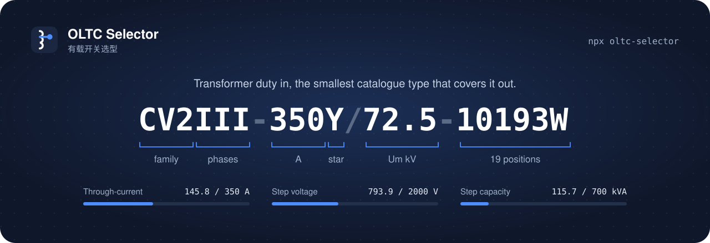
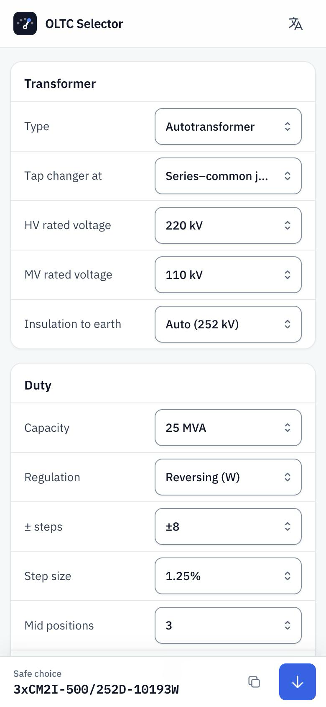
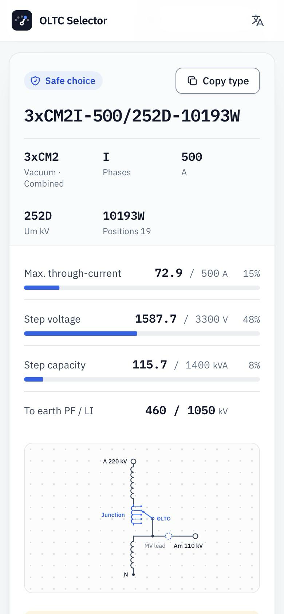
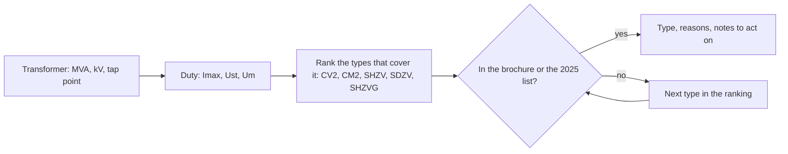

<div align="center">

**English** · [简体中文](README.zh-CN.md)



# OLTC Selector

**Enter the transformer duty. Get the smallest tap-changer type in the 2025 catalogue that covers it.**

[](https://www.npmjs.com/package/oltc-selector)
[](https://www.npmjs.com/package/oltc-selector)
[](https://github.com/erict16/oltc-selector/actions/workflows/deploy-pages.yml)

[](LICENSE)

[**Open the web page**](https://oltc-selector.vercel.app/) · [Mirror](https://erict16.github.io/oltc-selector/) · [npm](https://www.npmjs.com/package/oltc-selector) · [AI assistant guide](https://erict16.github.io/oltc-selector/agents/) · [Changelog](CHANGELOG.md)

</div>

> [!NOTE]
> This is a private helper, not a manufacturer's site. It gives no prices. The type is a starting point: get engineering confirmation before an order.

## Try it

A 25 MVA transformer, 110 kV, tapped at the star neutral:

```bash
npx -y oltc-selector@latest --lang en --mva 25 --kv 110 --tap neutral
```

```text
CV2III-350Y/72.5-10193W
Minimum-adequate path: CV2 in-tank vacuum compound OLTC (selector switch), Ium 350 A ≥ 146 A, Um 72.5 kV.
Basis: I = S/(√3×110 kV) = 131.2 A, lowest tap 145.8 A · Ust 793.9 V · neutral Um 72.5 (check the OS)
Note: Neutral insulation not given: sized at Um 72.5 kV; the order specification (OS) decides.
Insulation to earth open: Um 72.5 → CV2III-350Y/72.5-10193W · Um 126 → CV2III-350Y/126-10193W (take it from the tender's neutral / tap-winding insulation; use --earth-um)

Other
CV2III-600Y/72.5-10193W

Assumed: two-winding (default) · tap at neutral · star winding (default) · Um to earth 72.5 (not stated) · k=1.0 (default) · step=1.25% (default) · lowest tap at −8 (minus not stated; give +a/−b with --range or --minus) · reg=W reversing (default) · ±8 steps (default) · vacuum (default) · in tank (default) · phases=III (default)
```

The first line is the type. The lines after it say why, what you must still check, which other types cover the duty, and every default that was assumed.

## Three ways in, one engine

<table>
<tr>
<td width="33%" valign="top">
<h3>Web page</h3>
Every field is a dropdown, and the type updates as you change one. It works on a phone and on a laptop, in six languages.
<br><br>
<a href="https://oltc-selector.vercel.app/">Open the page</a>
</td>
<td width="33%" valign="top">
<h3>Command line</h3>
<code>oltc</code> reads flags or a pasted tender line and prints the type. <code>--json</code> is for scripts. Each run tells you when npm has a newer version.
<br><br>
<a href="#cli">Flags and examples</a>
</td>
<td width="33%" valign="top">
<h3>AI assistant</h3>
Send your assistant one line. It runs the same command and asks you for the data it does not have.
<br><br>
<a href="#with-an-ai-assistant">The line to send</a>
</td>
</tr>
</table>

All three call the same function, `selectOltc`, so they give the same type.

## The page

<p align="center">

&nbsp;&nbsp;&nbsp;&nbsp;

</p>

**The form** has three cards.

| Card | Fields |
|------|--------|
| Transformer | Type, where the tap changer sits, winding connection, rated voltage, insulation to earth |
| Duty | Capacity or through-current, regulation, ± steps, step size, mid positions, phases |
| Switch | On-load or off-circuit, arc medium, structure, mounting, impulse and power-frequency levels, safety factor |

**The result** shows, from top to bottom:

1. The type, with a button to copy it.
2. One cell for each coded part of the type.
3. The loads as bars: duty against rating for through-current, step voltage and step capacity.
4. The withstand levels to earth of the type.
5. A sketch of the winding. Click a point on it to move the tap changer there.
6. Notes you must act on.
7. Other types that also cover the duty.

Good to know:

- "Custom" in a dropdown opens a typed field.
- The form is kept in the address, after `#`. Copy the address to open the same selection on another computer.
- On a phone the type stays in a bar at the bottom. The arrow jumps to the full result.
- Printing gives the result card only.
- Languages: 中文, English, Tiếng Việt, Español, Türkçe, Bahasa Indonesia. The first visit follows the browser language.

## Read a type string

| Part | In `CV2III-350Y/72.5-10193W` | Meaning |
|------|------|---------|
| Family | `CV2` | Vacuum, compound (selector switch), in tank |
| Phases | `III` | Three-phase unit. `3x…I` is three single-phase units |
| Current | `350` | Rated through-current, A |
| Connection | `Y` | Star point. `D` is delta |
| Um | `72.5` | Highest voltage for equipment, kV |
| Tap code | `10193W` | 19 positions, 3 mid positions, reversing (`W`) |

<details>
<summary><b>Families the selector knows</b></summary>

<br>

| Family | Kind | Mounting |
|--------|------|----------|
| `CV2` | Vacuum, compound | In tank |
| `CM2` · `SHZV` · `SDZV` · `SHZVG` | Vacuum, combined | In tank |
| `HWV` | Vacuum, combined | On tank |
| `CV` · `SV` | Oil, compound | In tank |
| `CM` · `CMD` | Oil, combined | In tank |
| `CVT` · `CZ` | Vacuum, for dry-type transformers | Dry-type |
| `HWDK` | Oil, for reactors | Reactor |
| `WSL` | Off-circuit, cage | In tank |
| `WDG` · `WLG` · `WSG` | Off-circuit, drum | In tank |

</details>

## How it picks



The tap point sets the current, the step voltage and Um. A typed Y or D does not. The full rules are in [Selection rules](#selection-rules).

## With an AI assistant

Send this line to an assistant that can run shell commands:

```text
Use oltc-selector from npm to pick a tap-changer type for me. Run npx -y oltc-selector@latest --help first, then ask me for any missing data.
```

Then send the transformer data. The [guide](https://erict16.github.io/oltc-selector/agents/) has example questions in six languages.

## CLI

You do not need to clone this repository. Node.js 20 or later is needed.

```bash
npm i -g oltc-selector

oltc --iu 350 --um 40.5 --conn D --reg W --pm 8
# CV2III-350D/40.5-10193W

oltc --octc --iu 800 --um 72.5 --conn D --series II --contact 6x5
# WSLII-800D/72.5-6x5A

oltc --iu 600 --um 72.5 --conn Y --reg W --pm 8 --structure combined
# CM2III-600Y/72.5B-10193W

oltc --mva 25 --kv 110 --tap neutral --reg W --pm 8
# CV2III-350Y/72.5-10193W

oltc --mva 16 --kv 22 --tap line --winding star
# CV2III-600D/40.5-10193W

# Autotransformer tapped at the series/common junction (sized on the HV side)
oltc --mva 125 --kind auto --hv 225 --mv 115 --tap junction
# 3xCM2I-500/252D-10193W

# Or paste the tender line: YNa0 makes it an autotransformer
oltc --line "220/110/35kV-125MVA 225±8x1,25%/115/35kV YNa0d11"
# 3xCM2I-500/252D-10193W, plus the type at Um 126 / 170 / 252
```

Output is in Chinese by default; `--lang en` gives English. Every run asks npm for a newer version and prints a notice when there is one. Nothing is installed for you.

<details>
<summary><b>All flags</b></summary>

<br>

| Flag | Meaning | Default |
|------|---------|---------|
| `--line "text"` | Tender line: MVA, kV ratio with ±N×x%, vector group. Flags given beside it win. | |
| `--iu` / `--imax` | Max through-current Imax (A). **No** safety factor. | required unless `--mva` |
| `--mva` `--kv` | Transformer MVA + tap-side kV → Imax (min tap + `--k`). With `--iu`, `--kv` alone sets the winding voltage for the 220/330 kV rules | |
| `--k` | Safety factor ≥ 1, **capacity path only** | 1.0 |
| `--step-pct` | Step as a percent (1.25 means 1.25 %), capacity path only | 1.25 |
| `--os-imax` | Capacity path: the Imax the OS or maker states at the lowest tap (`--imax` beside `--mva` means this) | |
| `--kind two\|auto` | Transformer kind (`--auto` = `--kind auto`) | two-winding |
| `--tap` | Where the OLTC sits: `neutral` / `line` (two-winding), `junction` / `mv-line` (autotransformer). Sets current, Ust and Um. | neutral; junction with `--kind auto` |
| `--winding star\|delta` | Tapped winding connection (two-winding) | star |
| `--hv` `--mv` | Autotransformer HV / MV rated kV | |
| `--earth-um` | OLTC insulation to earth from the OS; overrides the rule | |
| `--across-li` `--across-ac` | Stated LI / AC withstand across the tap winding (kV): sets the selector grade B/C/D/DE | |
| `--um` | Equipment Um (kV) | derived from `--kv` if omitted |
| `--ust` | Step voltage (V) | 0, or derived on MVA path |
| `--conn Y\|D` | Switch star / delta on the `--iu` path (with `--mva`, use `--tap`) | Y |
| `--reg W\|G\|0` | Reversing / coarse-fine / linear | W |
| `--pm` | ± steps, a whole number | 8 |
| `--pos` / `--positions` | Operating positions (linear and off-circuit; on W/G the Fig. 3-3 row with that count) | |
| `--phases` | `I` / `II` / `III` | III |
| `--range +a/-b[xs%]` | Uneven range. W/G takes the Fig. 3-3 row the maker sells (+4/-12 → 10193W); the lowest tap uses −b | |
| `--minus` | Minus steps for the lowest-tap current, beside `--pm` / `--pos` | ± steps |
| `--mid 1\|3` | Mid positions of the W/G diagram, when Fig. 3-3 has the pair | brochure |
| `--octc` | Off-circuit 无载 (WSL cage; WDG/WLG/WSG drum). `--duty octc` is the same | on-load |
| `--structure` | `auto` / `combined` 组合式 / `compound` 复合式 / `cage` 笼式 / `drum` 鼓式 | `auto` |
| `--series` | OCTC wiring II IV V VI VII VIII | auto is linear IV for Y and D |
| `--mount` | `in-tank` / `on-tank` / `dry` / `reactor` (oil HWDK) | in-tank |
| `--oil` / `--vacuum` | Switching medium | vacuum (on-load) |
| `--contact` | OCTC contact e.g. `6x5` | |
| `--json` | Machine output (see below) | |
| `--lang en\|zh` | Output language. `OLTC_LANG=en` also works | zh |
| `--version` / `-v` | Print the version | |
| `--help` / `-h` | The flag list. Also shown when no flag is given | |
| `--no-update-check` | Skip the npm check made on every run. A newer version only prints a notice on stderr; nothing is installed. `OLTC_NO_UPDATE_CHECK=1` or `CI=1` also skip it. | check on |

`--structure auto` and omitting `--octc` match the web first paint: on-load, in-tank vacuum, minimum-adequate ranking.

Every flag with a value also takes `--flag=value`. A flag that cannot take effect is an error, not a silent default: `--series` or `--contact` without `--octc`, `--conn D` with `--tap neutral`, `--pm` and `--pos` that disagree, `--vacuum` with `--octc`, a flag given twice.

**Exit code:** `0` a type was found (or help / version); `1` no type, or bad input.

</details>

<details>
<summary><b><code>--json</code> keys</b></summary>

<br>

**`--json`** prints one object. For bad input (a flag that cannot be read) the object holds only `ok`, `version`, `model` and `errors`.

| Key | Holds |
|-----|-------|
| `ok` | `true` when `model` is a type |
| `version` | The CLI version |
| `model`, `why`, `alts` | The type, one line of reason, other types that cover the duty |
| `cautions` | Notes you must act on |
| `resolved` | What the engine was asked, as numbers: `throughCurrentA`, `umKv`, `stepVoltageV`, `connection`, `phases`, `regulation`, `plusMinusSteps`, `positions`, `dutyKind`, `mounting`, `medium` |
| `line` | The `--line` read-back: `kind`, `mva`, `voltagesKv`, `vectorGroup`, `warnings` (or `null`) |
| `basis` | Where current, Ust and Um came from on the capacity path (or `null`) |
| `umChoices` | The type at each Um class when the insulation to earth is open |
| `assumptions` | Every default that was applied, as text |
| `errors` | Why there is no type |

</details>

## Selection rules

<details>
<summary><b>The eleven rules the engine follows</b></summary>

<br>

1. **Minimum-adequate, not SHZV-by-default.** Rank **CV2 → CM2 → SHZV → SDZV → SHZVG**. SDZV (dual-break, Ust 6000 V) only when SHZV step voltage or step capacity is short. Prefer one three-phase unit over `3×` singles when a brochure III type exists.
2. **OLTC existence comes from brochure / catalogue axes** (`lib/catalog.ts`), **not price-list Y/D twins**. A 2025 list row that prices `CM2III-…D` the same as Y does **not** make `CM2III-…D` a type.
3. **No CV2-500.** CV2 III currents are 350 and 600 only.
4. **No combined III-D.** CM / CM2 / CMD / SHZV / SDZV / SHZVG three-phase strings are star-point Y. Cover delta with `3x…I-` when that I type exists. Compound **CV / CV2 / SV** and on-tank **HWV** III-D **do** exist. No SDZV II, I-1200/1500, or III-1300.
5. **Compound has no selector grade letter.** No `CV2III-350Y/40.5B-…`. Combined in-tank may have B/C/D/DE after Um.
6. **WSL / WDL existence is 2025-list row keys without prices** (`lib/listIndex.data.json`). Missing rows (no `WSLIV-2000D/126`, no `7x6E` @ 72.5) are not emitted.
7. **Drum OCTC is the sold WDG / WLG** (single-phase, `3x` per three-phase set, no Y/D in the string). Existence is the distinct sold OS rows (`DRUM_SOLD_ROWS` in `lib/listIndex.ts`). WDG IV is 5x5 up to 5 positions, V is 6x5 up to 6; no WDG on D. **WSG** is catalogue axes only (II/IV/V, 4x5/6x5, up to 6 positions) and stays for the D quote `WSGII-800D/40.5-4x5A`.
8. **Typing Imax (`--iu`) does not apply a safety factor.** `--k` only applies on the transformer-capacity (`--mva`) path.
9. **Um is set where the tap changer sits** (`lib/transformer.ts`). Line end: the winding system's class (132 kV → 145, 220 kV → 252). Neutral: the full class up to 72.5; above that 72.5 is assumed and flagged. Autotransformer: the HV system's class, combined types only (no CV / CV2 / SV).
10. **Tapped windings on 220 kV class and above take combined types only.** 2025–2026 OS: 67 of 67 were CM / CM2 / SHZV.
11. **An open Um is shown as a choice.** Star points above 72.5 and autotransformers list the type at each Um class; the tender's insulation picks one (`--earth-um`, or a row on the card).

</details>

## Develop

```bash
npm install
npm run dev      # http://127.0.0.1:3000
npm test
npm run lint
npm run build    # static export to out/
npm run pack:cli
```

| Path | What it holds |
|------|---------------|
| `lib/` | The engine, catalogue data, tap codes, translations, tests |
| `lib/formState.ts`, `lib/formEdits.ts`, `lib/formUrl.ts` | The form: its state, each edit, and the link format |
| `components/SelectorApp.tsx`, `components/selector/` | The page and its parts |
| `app/globals.css` | Styles |
| `scripts/oltc.ts` | CLI entry |

Every push to `master` deploys to Vercel and to GitHub Pages. Both run `npm test` before the build. A pull request runs lint, the type check, the tests and the build (`.github/workflows/test.yml`).

## OS regression

`docs/replay/` is not in the repository: it holds sold-order data (buyer names, serials) and stays on the maintainer's disk. The tests that read it skip when it is absent. There, `2025-os-sales.xlsx` and `2026-os-sales.xlsx` hold sold type plus duty (Imax, Um, Ust, ±, Y/D, phases, serial). Rebuild from JSON:

```bash
python scripts/os-to-excel.py
```

With the data on disk, `npm test` runs shipped `selectOltc` on every complete row: no illegal type out; a legal sold type that covers the duty must appear in ranked results. CI and a fresh clone do not have the data, so these replay tests are skipped there.

## Terms

[Terms](https://oltc-selector.vercel.app/terms/) · [Privacy](https://oltc-selector.vercel.app/privacy/). For reference only.
