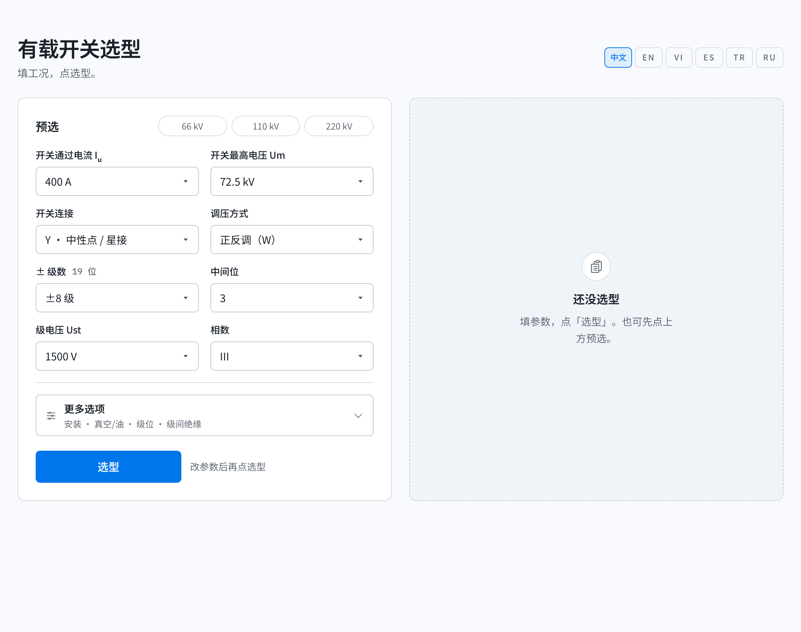

# OLTC Selector / 有载开关选型

填工况，给出 2025 目录里**最低满足**的型号。网页和 `oltc` CLI 共用同一份 `selectOltc` 引擎。

**CLI：** `npx -y oltc-selector@2.1.0`，命令是 `oltc`。Agent 技能包另放，不在这个仓库里。  
**网页：** [oltc-selector.vercel.app](https://oltc-selector.vercel.app/) · [GitHub Pages](https://erict16.github.io/oltc-selector/)

私人辅助，不是厂家官网。型号是起点，出 OS 前要工程确认。



## CLI

不需要 clone 本仓库。

```bash
npm i -g oltc-selector

oltc --iu 350 --um 40.5 --conn D --reg W --pm 8
# CV2III-350D/40.5-10193W

oltc --octc --iu 800 --um 72.5 --conn D --series II --contact 6x5
oltc --iu 600 --um 72.5 --conn Y --reg W --pm 8 --structure combined
oltc --mva 25 --kv 110 --tap neutral --reg W --pm 8
oltc --mva 16 --kv 22 --tap line --winding star
# CV2III-600D/40.5-10193W

# Autotransformer tapped at the series/common junction (sized on the HV side)
oltc --mva 125 --kind auto --hv 225 --mv 115 --tap junction
# 3xCM2I-500/252D-10193W
```

| Flag | Meaning | Default |
|------|---------|---------|
| `--iu` / `--imax` | Max through-current Imax (A). **No** safety factor. | required unless `--mva` |
| `--mva` `--kv` | Transformer MVA + tap-side kV → Imax (min tap + `--k`) | |
| `--k` | Safety factor ≥ 1, **capacity path only** | 1.0 |
| `--kind two\|auto` | Transformer kind (`--auto` = `--kind auto`) | two-winding |
| `--tap` | Where the OLTC sits: `neutral` / `line` (two-winding), `junction` / `mv-line` (autotransformer). Sets current, Ust and Um. | neutral |
| `--winding star\|delta` | Tapped winding connection (two-winding) | star |
| `--hv` `--mv` | Autotransformer HV / MV rated kV | |
| `--earth-um` | OLTC insulation to earth from the OS; overrides the rule | |
| `--um` | Equipment Um (kV) | derived from `--kv` on MVA path |
| `--ust` | Step voltage (V) | 0, or derived on MVA path |
| `--conn Y\|D` | Switch star / delta on the `--iu` path (with `--mva`, use `--tap`) | Y |
| `--reg W\|G\|0` | Reversing / coarse-fine / linear | W |
| `--pm` | ± steps | 8 |
| `--octc` | Off-circuit 无载 (WSL/WSG) | on-load |
| `--structure` | `auto` / `combined` 组合式 / `compound` 复合式 / `cage` 笼式 / `drum` 鼓式 | `auto` |
| `--series` | OCTC wiring II IV V VI VII VIII | auto is linear IV for Y and D |
| `--mount` | `in-tank` / `on-tank` / `dry` | in-tank |
| `--oil` / `--vacuum` | Switching medium | vacuum (on-load) |
| `--contact` | OCTC contact e.g. `6x5` | |
| `--json` | Machine output | |

`--structure auto` and omitting `--octc` match the web first paint: on-load, in-tank vacuum, minimum-adequate ranking.

## Selection rules

1. **Minimum-adequate, not SHZV-by-default.** Rank **CV2 → CM2 → SHZV → SDZV → SHZVG**. SDZV (dual-break, Ust 6000 V) only when SHZV step voltage or step capacity is short. Prefer one three-phase unit over `3×` singles when a brochure III type exists.
2. **OLTC existence comes from brochure / catalogue axes** (`lib/catalog.ts`), **not price-list Y/D twins**. A 2025 list row that prices `CM2III-…D` the same as Y does **not** make `CM2III-…D` a type.
3. **No CV2-500.** CV2 III currents are 350 and 600 only.
4. **No combined III-D.** CM / CM2 / CMD / SHZV / SDZV / SHZVG three-phase strings are star-point Y. Cover delta with `3x…I-` when that I type exists. Compound **CV / CV2 / SV** and on-tank **HWV** III-D **do** exist. No SDZV II, I-1200/1500, or III-1300.
5. **Compound has no selector grade letter.** No `CV2III-350Y/40.5B-…`. Combined in-tank may have B/C/D/DE after Um.
6. **WSL / WDL existence is 2025-list row keys without prices** (`lib/listIndex.data.json`). Missing rows (no `WSLIV-2000D/126`, no `7x6E` @ 72.5) are not emitted.
7. **WSG** is catalogue axes only (no 2025 list sheet in the index).
8. **Typing Imax (`--iu`) does not apply a safety factor.** `--k` only applies on the transformer-capacity (`--mva`) path.
9. **Um is set where the tap changer sits** (`lib/transformer.ts`). Line end: the winding system's class (132 kV → 145, 220 kV → 252). Neutral: the full class up to 72.5; above that 72.5 is assumed and flagged. Autotransformer: the HV system's class, combined types only (no CV / CV2 / SV).

## Web app

预选 66 / 110 / 220 kV 带常用工况。默认真变压器容量，星/角推出 Imax（最低分接和安全系数）。调压侧电压推出 Um。型号随参数实时更新，结果卡把工况和型号额定并排列出（电流、级电压、级容量、开关绝缘）。开关一组默认折叠，折叠时一行显示当前取值。手机上型号固定在底栏，点箭头跳到完整结果。

```bash
npm install
npm run dev      # http://127.0.0.1:3000
npm test
npm run pack:cli
```

GitHub Pages：`npm run build:gh`（`GH_PAGES=true`）。Vercel 根路径，不要设 `GH_PAGES`。

语言：中文、English、Tiếng Việt、Español、Türkçe、Bahasa Indonesia。

## OS regression

`docs/replay/2025-os-sales.xlsx` and `2026-os-sales.xlsx` hold sold type plus duty (Imax, Um, Ust, ±, Y/D, phases, serial). Rebuild from JSON:

```bash
python scripts/os-to-excel.py
```

`npm test` runs shipped `selectOltc` on every complete row: no illegal type out; a legal sold type that covers the duty must appear in ranked results.

## 许可

[条款](https://erict16.github.io/oltc-selector/terms/) · [隐私](https://erict16.github.io/oltc-selector/privacy/)。仅供参考。
