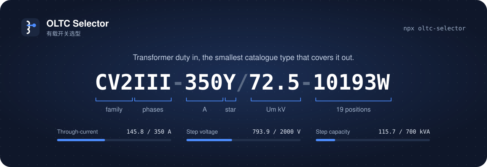
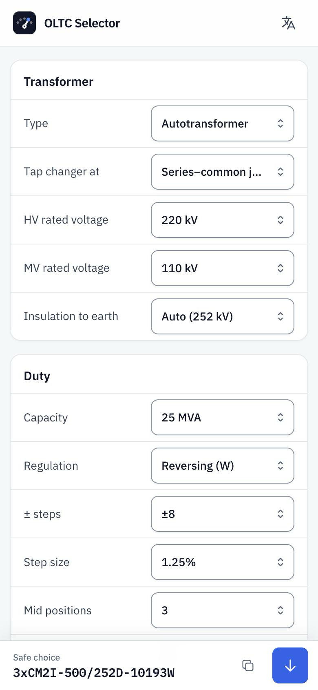
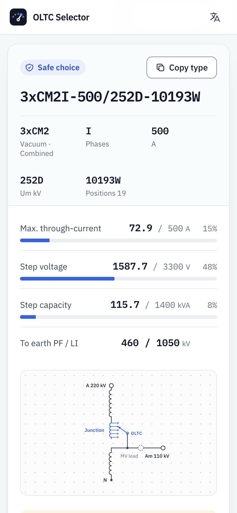
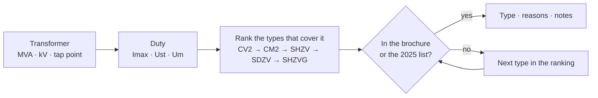

<div align="center">

**English** · [简体中文](README.zh-CN.md)



# OLTC Selector

**Transformer duty in. The smallest catalogue tap-changer type that covers it out.**

On-load and off-circuit · 2025 catalogue · six languages · no prices

[](https://www.npmjs.com/package/oltc-selector)
[](https://www.npmjs.com/package/oltc-selector)
[](https://github.com/erict16/oltc-selector/actions/workflows/deploy-pages.yml)

[](LICENSE)

### [Open the web page](https://oltc-selector.vercel.app/) · [Mirror](https://erict16.github.io/oltc-selector/) · [CLI page](https://oltc-selector.vercel.app/agents/) · [npm](https://www.npmjs.com/package/oltc-selector) · [Release notes](CHANGELOG.md)

</div>

> [!NOTE]
> A private helper, not a manufacturer's site. It gives no prices. The type is a starting point: get engineering confirmation before an order.

**On this page:** [Try it](#try-it) · [Read the type](#read-the-type) · [Choose your way in](#choose-your-way-in) · [Web page](#web-page) · [AI assistant](#ai-assistant) · [CLI](#cli) · [How it picks](#how-it-picks) · [Develop](#develop)

<br>

## Try it

No install. Node.js 20 or later:

```bash
npx -y oltc-selector@latest --lang en --mva 25 --kv 110 --tap neutral
```

```text
CV2III-350Y/72.5-10193W
Minimum-adequate path: CV2 in-tank vacuum compound OLTC (selector switch), Ium 350 A ≥ 146 A, Um 72.5 kV.
Basis: I = S/(√3×110 kV) = 131.2 A, lowest tap 145.8 A · Ust 793.9 V · neutral Um 72.5
Note: Neutral insulation not given: sized at Um 72.5 kV; the order specification (OS) decides.
By insulation class: Um 72.5 → CV2III-350Y/72.5-10193W · Um 126 → CV2III-350Y/126-10193W (set it with --earth-um)

Other types that cover the duty
CV2III-600Y/72.5-10193W

Assumed: step 1.25% · lowest tap at −8 (not stated) · W reversing · ±8 steps
```

| Line | Tells you |
|------|-----------|
| 1 | **The type.** Copy it into the inquiry. |
| `Minimum-adequate path` | Why this type: its rating against the duty. |
| `Basis` | Where the current, step voltage and Um came from. |
| `Note` | What you must still check. Act on these. |
| `By insulation class` | The type at each Um, when the insulation to earth is open. |
| `Other types` | Larger types that also cover the duty. |
| `Assumed` | Every default that could change the type. |

## Read the type

| Part | In `CV2III-350Y/72.5-10193W` | Meaning |
|------|:----:|---------|
| Family | `CV2` | Vacuum, compound (selector switch), in tank |
| Phases | `III` | One three-phase unit. `3x…I` is three single-phase units |
| Current | `350` | Rated through-current, A |
| Connection | `Y` | Star point. `D` is delta |
| Um | `72.5` | Highest voltage for equipment, kV |
| Tap code | `10193W` | 19 positions, 3 mid positions, reversing (`W`) |

<details>
<summary><b>All families the selector knows</b></summary>

<br>

| Family | Kind | Mounting |
|--------|------|----------|
| `CV2` | Vacuum, compound | In tank |
| `CM2` · `SHZV` · `SDZV` · `SHZVG` | Vacuum, combined | In tank |
| `HWV` | Vacuum, combined | On tank |
| `CV` · `SV` | Oil, compound | In tank |
| `CM` · `CMD` | Oil, combined | In tank |
| `CVT` · `CZ` | Vacuum, for dry-type transformers | Dry-type |
| `HWDK` | Oil, for reactors | Reactor |
| `WSL` | Off-circuit, cage | In tank |
| `WDG` · `WLG` · `WSG` | Off-circuit, drum | In tank |

</details>

## Choose your way in

All three call the same function, `selectOltc`, so they give the same type.

<table>
<tr>
<td width="33%" valign="top">

### Web page

Every field is a dropdown. The type changes as you change a field. Works on a phone, in six languages.

**[Open the page →](https://oltc-selector.vercel.app/)**

</td>
<td width="33%" valign="top">

### AI assistant

Send your assistant one line. It runs the CLI for you and asks for the data it does not have.

**[The line to send →](#ai-assistant)**

</td>
<td width="33%" valign="top">

### Command line

`oltc` takes flags or a pasted tender line. `--json` is for scripts.

**[Recipes and flags →](#cli)**

</td>
</tr>
</table>

## Web page

<p align="center">

&nbsp;&nbsp;&nbsp;

</p>

| Card | What you set |
|------|--------------|
| **Transformer** | Kind, where the tap changer sits, tapped winding, rated voltage, insulation to earth |
| **Duty** | Capacity or through-current, regulation, ± steps, step size, mid positions, phases |
| **Tap changer** | On-load or off-circuit, interrupter, construction, mounting, impulse and power-frequency levels, safety factor |

The result card shows the type with a copy button, one cell per coded part, the loads as bars (current, step voltage, step capacity), the withstand levels to earth, a winding sketch, the notes you must act on, and the other types that cover the duty. Click another type in that list to put it on the card.

<details>
<summary><b>Good to know</b></summary>

<br>

- **Custom** in a dropdown opens a typed field.
- The form lives in the address after `#`. Send the address and the other person sees the same selection.
- Click a point on the winding sketch to move the tap changer there.
- On a phone the type stays in a bar at the bottom. Its arrow jumps to the full result.
- Printing gives the result card only.
- Languages: 中文, English, Tiếng Việt, Español, Türkçe, Bahasa Indonesia. The first visit follows the browser language.

</details>

## AI assistant

Any assistant that can run shell commands works (Claude, ChatGPT, Codex). Send it this line:

```text
Use oltc-selector from npm to pick a tap-changer type for me. Run npx -y oltc-selector@latest --help first, then ask me for any missing data.
```

Then send the transformer data the way you would write it in a chat:

> Pick one for a transformer with both on-load and off-circuit taps: 110 kV, on-load ±8×1.25%, off-circuit 5 positions, 350 A, taps at the HV neutral.

It answers with the type, the reasons and the notes. The [CLI page](https://oltc-selector.vercel.app/agents/) has the line and more examples in six languages.

## CLI

```bash
npm i -g oltc-selector
```

Then `oltc --help`. You can also skip the install and run `npx -y oltc-selector@latest` with the same flags.

### Recipes

Find the row that matches what you have.

| You have | Run | You get |
|----------|-----|---------|
| Max current and Um | `oltc --iu 350 --um 40.5 --conn D` | `CV2III-350D/40.5-10193W` |
| Capacity and voltage, tapped at the star point | `oltc --mva 25 --kv 110 --tap neutral` | `CV2III-350Y/72.5-10193W` |
| The same, tapped at the line end | `oltc --mva 16 --kv 22 --tap line --winding star` | `CV2III-600D/40.5-10193W` |
| An autotransformer | `oltc --mva 125 --kind auto --hv 225 --mv 115` | `3xCM2I-500/252D-10193W` |
| A line from the tender | `oltc --line "125MVA 225±8x1,25%/115/35kV YNa0d11"` | `3xCM2I-500/252D-10193W` |
| An uneven range | `oltc --mva 40 --kv 110 --range +4/-12x1.25%` | `CV2III-350Y/72.5-10193W` |
| Insulation to earth from the OS | `oltc --mva 25 --kv 110 --tap neutral --earth-um 126` | `CV2III-350Y/126-10193W` |
| An off-circuit duty | `oltc --octc --iu 800 --um 72.5 --conn D --series II --contact 6x5` | `WSLII-800D/72.5-6x5A` |
| A dry-type transformer | `oltc --mva 1.6 --kv 33 --tap line --mount dry --reg 0 --pm 4` | `3xCZI-500/40.5-9` |
| A combined type wanted | `oltc --iu 600 --um 72.5 --structure combined` | `CM2III-600Y/72.5B-10193W` |
| A script to feed | `oltc --json --iu 350 --um 40.5 --conn D` | One JSON object |

Output is Chinese by default. `--lang en` (or `OLTC_LANG=en`) prints English. On a Chinese run an error prints in Chinese, then English.

Each run asks npm for a newer version and prints a notice on stderr when there is one. It never installs anything. `--no-update-check`, `OLTC_NO_UPDATE_CHECK=1` or `CI=1` turn the check off.

### Flags

Grouped like the cards of the web page.

<details>
<summary><b>Transformer</b></summary>

<br>

| Flag | Meaning | Default |
|------|---------|---------|
| `--line "text"` | Tender line: MVA, kV ratio with ±N×x%, vector group. Reads autotransformer from `YNa0` / auto, delta line end from `D`, star neutral from `Y`. Flags given beside it win. `--nameplate` is the same | |
| `--kind two\|auto` | Transformer kind. `--auto` is `--kind auto` | two-winding |
| `--tap` | Where the tap changer sits: `neutral` / `line` (two-winding), `junction` / `mv-line` (autotransformer). Sets current, Ust and Um | neutral; junction with `--kind auto` |
| `--winding star\|delta` | Tapped winding connection (two-winding). Star I = S/(√3U), delta I = S/(3U) | star |
| `--kv` | Rated voltage of the tapped winding (kV). With `--iu`, it sets the winding voltage for the 220 / 330 kV rules | |
| `--hv` `--mv` | Autotransformer HV / MV rated voltage (kV) | |
| `--earth-um` | Insulation to earth from the OS or maker (kV). Overrides the rule | rule |

</details>

<details>
<summary><b>Duty</b></summary>

<br>

| Flag | Meaning | Default |
|------|---------|---------|
| `--mva` | Transformer capacity. With `--kv`: Imax from rated current at the lowest tap | |
| `--iu` / `--imax` | Max through-current Imax (A). **No** safety factor | required unless `--mva` |
| `--os-imax` | Capacity path: the Imax the OS or maker states at the lowest tap. `--imax` beside `--mva` means this | |
| `--k` | Safety factor ≥ 1, **capacity path only** | 1.0 |
| `--reg W\|G\|0` | Reversing / coarse-fine / linear | W |
| `--pm` | ± steps, a whole number | 8 |
| `--pos` / `--positions` | Operating positions (linear and off-circuit; on W/G the Fig. 3-3 row with that count) | |
| `--range +a/-b[xs%]` | Uneven range. W/G takes the Fig. 3-3 row the maker sells (+4/-12 → 10193W); the lowest tap uses −b | |
| `--minus` | Minus steps for the lowest-tap current, beside `--pm` / `--pos` | ± steps |
| `--step-pct` | Step as a percent (1.25 means 1.25 %). Capacity path only | 1.25 |
| `--mid 1\|3` | Mid positions of the W/G diagram, when Fig. 3-3 has the pair | brochure |
| `--ust` | Step voltage (V). Given, it is the OS figure and a floor | derived on the capacity path |
| `--um` | Equipment Um (kV) | derived from `--kv` |
| `--conn Y\|D` | Switch at the star point / line end. `--iu` path only; with `--mva` or `--line` use `--tap` | Y |
| `--phases` | `I` / `II` / `III` | III |

</details>

<details>
<summary><b>Tap changer</b></summary>

<br>

| Flag | Meaning | Default |
|------|---------|---------|
| `--octc` | Off-circuit (WSL cage; WDG / WLG / WSG drum). `--duty octc` is the same | on-load |
| `--structure` | `auto` / `combined` / `compound` / `cage` / `drum` | auto |
| `--series` | Off-circuit wiring `II` `IV` `V` `VI` `VII` `VIII` | auto: linear IV for Y and D |
| `--mount` | `in-tank` / `on-tank` / `dry` / `reactor` (oil HWDK) | in-tank |
| `--vacuum` / `--oil` | Switching medium | vacuum (on-load) |
| `--contact` | Off-circuit contact, e.g. `6x5` | |
| `--across-li` `--across-ac` | Stated LI / AC withstand across the tap winding (kV). Sets the selector grade B / C / D / DE | |

</details>

<details>
<summary><b>Output</b></summary>

<br>

| Flag | Meaning |
|------|---------|
| `--json` | One JSON object on stdout, nothing on stderr. Keys below |
| `--lang en\|zh` | Output language. `OLTC_LANG=en` also works. Default zh |
| `--version` / `-v` | Print the version |
| `--help` / `-h` | The flag list. Also shown when no flag is given |
| `--no-update-check` | Skip the npm version check |

</details>

Every flag with a value also takes `--flag=value`. A flag that cannot take effect is an error, not a silent default: `--series` or `--contact` without `--octc`, `--conn D` with `--tap neutral`, `--pm` and `--pos` that disagree, `--vacuum` with `--octc`, a flag given twice.

With no `--octc` and `--structure auto` the CLI matches the web page's first paint: on-load, in-tank vacuum, minimum-adequate ranking.

**Exit code:** `0` a type was found (or help / version). `1` no type, or bad input.

<details>
<summary><b><code>--json</code> keys</b></summary>

<br>

For bad input the object holds only `ok`, `version`, `model` and `errors`.

| Key | Holds |
|-----|-------|
| `ok` | `true` when `model` is a type |
| `version` | The CLI version |
| `model`, `why`, `alts` | The type, one line of reason, other types that cover the duty |
| `cautions` | Notes you must act on |
| `resolved` | What the engine was asked, as numbers: `throughCurrentA`, `umKv`, `stepVoltageV`, `connection`, `phases`, `regulation`, `plusMinusSteps`, `positions`, `dutyKind`, `mounting`, `medium` |
| `line` | The `--line` read-back: `kind`, `mva`, `voltagesKv`, `vectorGroup`, `warnings` (or `null`) |
| `basis` | Where current, Ust and Um came from on the capacity path (or `null`) |
| `umChoices` | The type at each Um class when the insulation to earth is open |
| `assumptions` | Every default that was applied, as text. The text output names only those that could change the type |
| `errors` | Why there is no type. Chinese then English; English alone with `--lang en` |

</details>

## How it picks



The tap point sets the current, the step voltage and Um. A typed Y or D does not.

<details>
<summary><b>The eleven selection rules</b></summary>

<br>

1. **Minimum-adequate, not SHZV-by-default.** Rank **CV2 → CM2 → SHZV → SDZV → SHZVG**. SDZV (dual-break, Ust 6000 V) only when SHZV step voltage or step capacity is short. Prefer one three-phase unit over `3×` singles when a brochure III type exists.
2. **OLTC existence comes from brochure / catalogue axes** (`lib/catalog.ts`), **not price-list Y/D twins**. A 2025 list row that prices `CM2III-…D` the same as Y does **not** make `CM2III-…D` a type.
3. **No CV2-500.** CV2 III currents are 350 and 600 only.
4. **No combined III-D.** CM / CM2 / CMD / SHZV / SDZV / SHZVG three-phase strings are star-point Y. Cover delta with `3x…I-` when that I type exists. Compound **CV / CV2 / SV** and on-tank **HWV** III-D **do** exist. No SDZV II, I-1200/1500, or III-1300.
5. **Compound has no selector grade letter.** No `CV2III-350Y/40.5B-…`. Combined in-tank may have B/C/D/DE after Um.
6. **WSL / WDL existence is 2025-list row keys without prices** (`lib/listIndex.data.json`). Missing rows (no `WSLIV-2000D/126`, no `7x6E` @ 72.5) are not emitted.
7. **Drum OCTC is the sold WDG / WLG** (single-phase, `3x` per three-phase set, no Y/D in the string). Existence is the distinct sold OS rows (`DRUM_SOLD_ROWS` in `lib/listIndex.ts`). WDG IV is 5x5 up to 5 positions, V is 6x5 up to 6; no WDG on D. **WSG** is catalogue axes only (II/IV/V, 4x5/6x5, up to 6 positions) and stays for the D quote `WSGII-800D/40.5-4x5A`.
8. **Typing Imax (`--iu`) does not apply a safety factor.** `--k` only applies on the transformer-capacity (`--mva`) path.
9. **Um is set where the tap changer sits** (`lib/transformer.ts`). Line end: the winding system's class (132 kV → 145, 220 kV → 252). Neutral: the full class up to 72.5; above that 72.5 is assumed and flagged. Autotransformer: the HV system's class, combined types only (no CV / CV2 / SV).
10. **Tapped windings on 220 kV class and above take combined types only.** 2025–2026 OS: 67 of 67 were CM / CM2 / SHZV.
11. **An open Um is shown as a choice.** Star points above 72.5 and autotransformers list the type at each Um class; the tender's insulation picks one (`--earth-um`, or a row on the card).

</details>

## Develop

Node.js 22.12 or later for the repository (the published CLI runs on 20).

```bash
npm install
npm run dev        # http://127.0.0.1:3000
npm test
npm run lint
npm run build      # static export to out/
npm run oltc -- --help   # the CLI from source
npm run pack:cli   # the npm package, in pack/
```

| Path | Holds |
|------|-------|
| `lib/` | The engine (`selectOltc`), catalogue data, tap codes, translations, tests |
| `lib/cli.ts`, `scripts/oltc.ts` | The CLI and its entry |
| `lib/formState.ts`, `lib/formEdits.ts`, `lib/formUrl.ts` | The form: its state, each edit, the link format |
| `components/SelectorApp.tsx`, `components/selector/` | The selector page and its parts |
| `components/AgentsGuide.tsx`, `lib/i18nAgents.ts` | The CLI page and its copy |
| `app/globals.css` | Styles |

Every push to `master` deploys to Vercel and to GitHub Pages; both run `npm test` before the build. A pull request runs lint, the type check, the tests and the build (`.github/workflows/test.yml`).

<details>
<summary><b>OS regression data</b></summary>

<br>

`docs/replay/` is not in the repository: it holds sold-order data (buyer names, serials) and stays on the maintainer's disk. There, `2025-os-sales.xlsx` and `2026-os-sales.xlsx` hold the sold type and its duty (Imax, Um, Ust, ±, Y/D, phases, serial). Rebuild them from JSON:

```bash
python scripts/os-to-excel.py
```

With the data on disk, `npm test` runs `selectOltc` on every complete row: no illegal type may come out, and a legal sold type that covers the duty must appear in the ranked results. CI and a fresh clone do not have the data, so these tests skip there.

</details>

---

<div align="center">

[Terms](https://oltc-selector.vercel.app/terms/) · [Privacy](https://oltc-selector.vercel.app/privacy/) · MIT · For reference only

</div>
