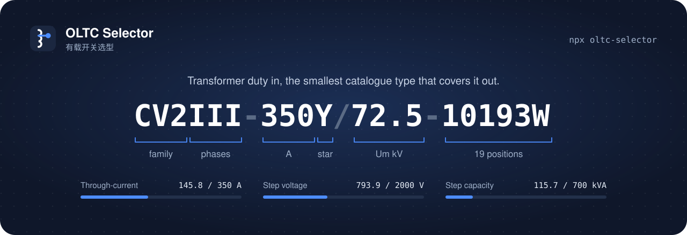
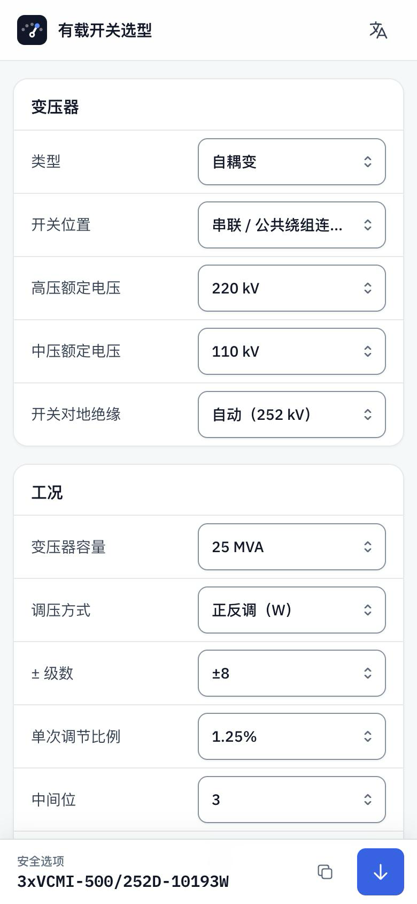
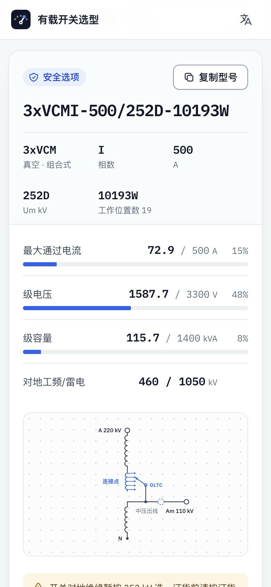
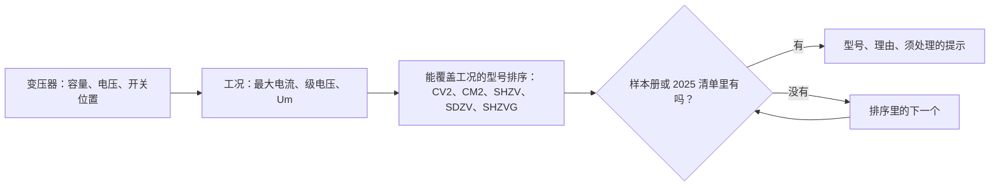

<div align="center">

[English](README.md) · **简体中文**



# 有载开关选型

**填变压器工况，得到 2025 样本册里能覆盖它的最小分接开关型号。**

[](https://www.npmjs.com/package/oltc-selector)
[](https://www.npmjs.com/package/oltc-selector)
[](https://github.com/erict16/oltc-selector/actions/workflows/deploy-pages.yml)

[](LICENSE)

[**打开网页版**](https://oltc-selector.vercel.app/) · [镜像](https://erict16.github.io/oltc-selector/) · [npm](https://www.npmjs.com/package/oltc-selector) · [AI 助手用法](https://erict16.github.io/oltc-selector/agents/) · [更新记录](CHANGELOG.md)

</div>

> [!NOTE]
> 这是个人做的辅助工具，不是厂家网站，也不含价格。型号只是起点，订货前需要工程确认。

## 试一下

一台 25 MVA、110 kV、中性点调压的变压器：

```bash
npx -y oltc-selector@latest --mva 25 --kv 110 --tap neutral
```

```text
CV2III-350Y/72.5-10193W
最低满足路径：CV2 箱内真空复合式有载开关（选择开关），Ium 350 A ≥ 需求 146 A，Um 72.5 kV。
依据：I = S/(√3×110 kV) = 131.2 A，最低档 145.8 A · Ust 793.9 V · 中性点 Um 72.5（待 OS 核对）
注意：中性点绝缘未给，先按 Um 72.5 kV 选，以订货规范（OS）为准。
对地绝缘未定：Um 72.5 → CV2III-350Y/72.5-10193W · Um 126 → CV2III-350Y/126-10193W（按招标的中性点/调压绕组绝缘取，用 --earth-um）

其他
CV2III-600Y/72.5-10193W

假定：双绕组（默认） · 开关在中性点 · 星形绕组（默认） · 对地 Um 72.5（未指定） · k=1.0（默认） · step=1.25%（默认） · 最低档按 −8 算（−档未指定，+a/−b 用 --range 或 --minus） · reg=W 正反调（默认） · ±8 档（默认） · 真空（默认） · 箱内（默认） · 相数=III（默认）
```

第一行是型号。后面几行说明理由、还要核对什么、还有哪些型号也能用，以及用了哪些默认值。

## 三种用法，同一套引擎

<table>
<tr>
<td width="33%" valign="top">
<h3>网页</h3>
每一项都是下拉框，改一项，型号马上更新。手机和电脑都能用，有六种语言。
<br><br>
<a href="https://oltc-selector.vercel.app/">打开网页</a>
</td>
<td width="33%" valign="top">
<h3>命令行</h3>
<code>oltc</code> 读参数或一行招标文字，输出型号。<code>--json</code> 给脚本用。每次运行都会查 npm 有没有新版本，有就提示。
<br><br>
<a href="#命令行">参数和例子</a>
</td>
<td width="33%" valign="top">
<h3>AI 助手</h3>
给助手发一句话。它会运行同一条命令，缺的参数来问你。
<br><br>
<a href="#用-ai-助手">要发的那句话</a>
</td>
</tr>
</table>

三种用法调用的是同一个函数 `selectOltc`，所以结果一样。

## 网页

<p align="center">

&nbsp;&nbsp;&nbsp;&nbsp;

</p>

**表单**有三张卡。

| 卡片 | 内容 |
|------|------|
| 变压器 | 类型、开关位置、调压绕组接法、额定电压、开关对地绝缘 |
| 工况 | 容量或通过电流、调压方式、± 级数、单次调节比例、中间位、相数 |
| 开关 | 有载或无载、灭弧方式、开关结构、安装方式、雷电冲击和工频耐压、安全系数 |

**结果**从上到下是：

1. 型号，旁边有复制按钮。
2. 型号的每一段各占一格，写明含义。
3. 负载条：最大通过电流、级电压、级容量，工况对额定值。
4. 该型号的对地耐压水平。
5. 绕组示意图。点图上的点，可以把开关换到那个位置。
6. 须处理的提示。
7. 其他也能覆盖工况的型号。

还有几点：

- 下拉框里选“自定义”，可以自己输入数值。
- 表单内容保存在网址里（`#` 后面）。复制网址，在另一台电脑上打开就是同一个选型。
- 手机上型号固定在底部，点箭头跳到完整结果。
- 打印时只出结果卡。
- 语言：中文、English、Tiếng Việt、Español、Türkçe、Bahasa Indonesia。第一次打开跟随浏览器语言。

## 型号怎么读

| 部分 | 在 `CV2III-350Y/72.5-10193W` 里 | 含义 |
|------|------|------|
| 系列 | `CV2` | 真空、复合式（选择开关）、箱内 |
| 相数 | `III` | 三相一台。`3x…I` 是三台单相 |
| 电流 | `350` | 额定通过电流，A |
| 接法 | `Y` | 星形中性点。`D` 是三角形 |
| Um | `72.5` | 设备最高电压，kV |
| 档位码 | `10193W` | 19 个工作位置，3 个中间位，正反调（`W`） |

中文网页按国内叫法显示三个系列：`CV2` 显示为 `VCV-G`，`CM2` 显示为 `VCM`，`SHZVG` 显示为 `CHVT`。命令行和其他语言用上表的写法。

<details>
<summary><b>选型覆盖的系列</b></summary>

<br>

| 系列 | 类别 | 安装 |
|------|------|------|
| `CV2` | 真空，复合式 | 箱内 |
| `CM2` · `SHZV` · `SDZV` · `SHZVG` | 真空，组合式 | 箱内 |
| `HWV` | 真空，组合式 | 箱顶 |
| `CV` · `SV` | 油浸，复合式 | 箱内 |
| `CM` · `CMD` | 油浸，组合式 | 箱内 |
| `CVT` · `CZ` | 真空，干式变压器用 | 干式 |
| `HWDK` | 油浸，电抗器用 | 电抗器 |
| `WSL` | 无载，笼式 | 箱内 |
| `WDG` · `WLG` · `WSG` | 无载，鼓式 | 箱内 |

</details>

## 怎么选出来的



电流、级电压和 Um 由开关所在的位置决定，不由手填的 Y 或 D 决定。完整规则见[英文版的 Selection rules](README.md#selection-rules)。

## 用 AI 助手

把这句话发给能运行命令的助手：

```text
请用 npm 上的 oltc-selector 帮我选分接开关型号。先运行 npx -y oltc-selector@latest --help 看用法，缺的参数来问我。
```

然后把变压器参数发给它。[用法页](https://erict16.github.io/oltc-selector/agents/)有例子。

## 命令行

不需要克隆这个仓库。需要 Node.js 20 或更高版本。

```bash
npm i -g oltc-selector

oltc --iu 350 --um 40.5 --conn D --reg W --pm 8
# CV2III-350D/40.5-10193W

oltc --mva 25 --kv 110 --tap neutral --reg W --pm 8
# CV2III-350Y/72.5-10193W

# 无载
oltc --octc --iu 800 --um 72.5 --conn D --series II --contact 6x5
# WSLII-800D/72.5-6x5A

# 自耦变，开关在串联/公共绕组连接点
oltc --mva 125 --kind auto --hv 225 --mv 115 --tap junction
# 3xCM2I-500/252D-10193W

# 或者直接贴一行招标文字
oltc --line "220/110/35kV-125MVA 225±8x1,25%/115/35kV YNa0d11"
# 3xCM2I-500/252D-10193W
```

默认输出中文，`--lang en` 输出英文。每次运行都会查 npm 有没有新版本，有就提示，不会自动安装。

常用参数：

| 参数 | 含义 | 默认 |
|------|------|------|
| `--line "文字"` | 一行招标文字：容量、电压比和 ±N×x%、联结组 | |
| `--mva` `--kv` | 变压器容量和调压侧电压，由它们算最大电流 | |
| `--iu` | 直接给最大通过电流（A），不乘安全系数 | |
| `--tap` | 开关位置：`neutral` / `line`（双绕组），`junction` / `mv-line`（自耦变） | `neutral` |
| `--kind two\|auto` | 双绕组或自耦变 | 双绕组 |
| `--hv` `--mv` | 自耦变的高压、中压额定电压 | |
| `--reg W\|G\|0` | 正反调 / 粗细调 / 线性调 | `W` |
| `--pm` | ± 级数 | 8 |
| `--earth-um` | 订货规范给的开关对地绝缘 Um | |
| `--octc` | 无载 | 有载 |
| `--json` | 给程序读的输出 | |
| `--lang en\|zh` | 输出语言 | `zh` |

全部参数运行 `oltc --help`，或看[英文版的参数表](README.md#cli)。

## 开发

见[英文版的 Develop](README.md#develop)。

## 条款

[条款](https://oltc-selector.vercel.app/terms/) · [隐私](https://oltc-selector.vercel.app/privacy/)。仅供参考。
