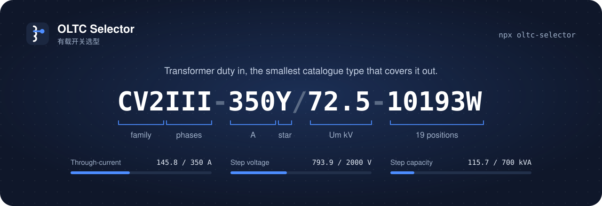
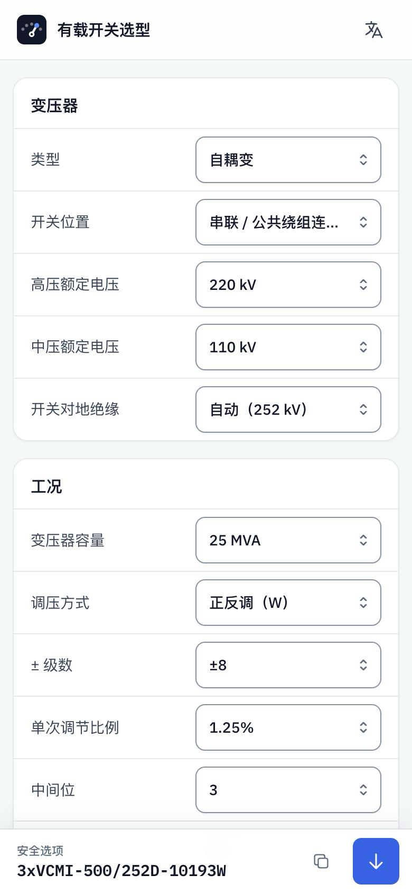
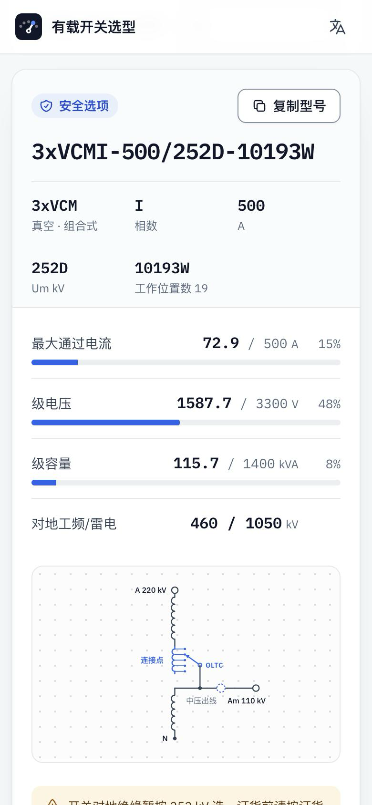
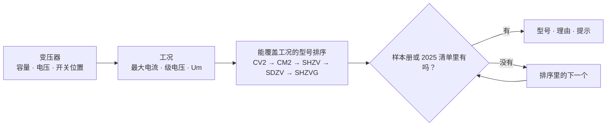

<div align="center">

[English](README.md) · **简体中文**



# 有载开关选型

**填变压器工况，得到 2025 样本册里能覆盖它的最小分接开关型号。**

有载和无载 · 2025 样本册 · 六种语言 · 不含价格

[](https://www.npmjs.com/package/oltc-selector)
[](https://www.npmjs.com/package/oltc-selector)
[](https://github.com/erict16/oltc-selector/actions/workflows/deploy-pages.yml)

[](LICENSE)

### [打开网页版](https://oltc-selector.vercel.app/) · [镜像](https://erict16.github.io/oltc-selector/) · [CLI 页](https://oltc-selector.vercel.app/agents/) · [npm](https://www.npmjs.com/package/oltc-selector) · [更新记录](CHANGELOG.md)

</div>

> [!NOTE]
> 这是个人做的辅助工具，不是厂家网站，也不含价格。型号只是起点，订货前需要工程确认。

**本页：** [试一下](#试一下) · [读懂型号](#读懂型号) · [三种用法](#三种用法) · [网页](#网页) · [AI 助手](#ai-助手) · [命令行](#命令行) · [怎么选的](#怎么选的) · [开发](#开发)

<br>

## 试一下

不用安装，有 Node.js 20 或更高版本就行：

```bash
npx -y oltc-selector@latest --mva 25 --kv 110 --tap neutral
```

```text
CV2III-350Y/72.5-10193W
最低满足路径：CV2 箱内真空复合式有载开关（选择开关），Ium 350 A ≥ 需求 146 A，Um 72.5 kV。
依据：I = S/(√3×110 kV) = 131.2 A，最低档 145.8 A · Ust 793.9 V · 中性点 Um 72.5
注意：中性点绝缘未给，先按 Um 72.5 kV 选，以订货规范为准。
各绝缘等级对应型号：Um 72.5 → CV2III-350Y/72.5-10193W · Um 126 → CV2III-350Y/126-10193W（用 --earth-um 指定）

其他可选
CV2III-600Y/72.5-10193W

假定：每级 1.25% · 最低档按 −8（未指定） · W 正反调 · ±8 档
```

| 哪一行 | 说什么 |
|------|------|
| 第 1 行 | **型号。** 直接复制去询价。 |
| `最低满足路径` | 为什么是它：额定值对工况。 |
| `依据` | 电流、级电压、Um 是怎么来的。 |
| `注意` | 还要你核对的事，要处理。 |
| `各绝缘等级对应型号` | 对地绝缘没定时，每个 Um 等级对应的型号。 |
| `其他可选` | 也能覆盖工况的更大型号。 |
| `假定` | 会影响型号的默认值。 |

## 读懂型号

| 部分 | 在 `CV2III-350Y/72.5-10193W` 里 | 含义 |
|------|:----:|------|
| 系列 | `CV2` | 真空、复合式（选择开关）、箱内 |
| 相数 | `III` | 三相一台。`3x…I` 是三台单相 |
| 电流 | `350` | 额定通过电流，A |
| 接法 | `Y` | 星形中性点。`D` 是三角形 |
| Um | `72.5` | 设备最高电压，kV |
| 档位码 | `10193W` | 19 个工作位置，3 个中间位，正反调（`W`） |

中文网页按国内叫法显示三个系列：`CV2` 显示为 `VCV-G`，`CM2` 显示为 `VCM`，`SHZVG` 显示为 `CHVT`。命令行和其他语言用上表的写法。

<details>
<summary><b>选型覆盖的全部系列</b></summary>

<br>

| 系列 | 类别 | 安装 |
|------|------|------|
| `CV2` | 真空，复合式 | 箱内 |
| `CM2` · `SHZV` · `SDZV` · `SHZVG` | 真空，组合式 | 箱内 |
| `HWV` | 真空，组合式 | 箱顶 |
| `CV` · `SV` | 油浸，复合式 | 箱内 |
| `CM` · `CMD` | 油浸，组合式 | 箱内 |
| `CVT` · `CZ` | 真空，干式变压器用 | 干式 |
| `HWDK` | 油浸，电抗器用 | 电抗器 |
| `WSL` | 无载，笼式 | 箱内 |
| `WDG` · `WLG` · `WSG` | 无载，鼓式 | 箱内 |

</details>

## 三种用法

三种用法调用同一个函数 `selectOltc`，结果一样。

<table>
<tr>
<td width="33%" valign="top">

### 网页

每一项都是下拉框，改一项，型号马上更新。手机能用，有六种语言。

**[打开网页 →](https://oltc-selector.vercel.app/)**

</td>
<td width="33%" valign="top">

### AI 助手

给助手发一句话。它替你跑命令，缺的参数来问你。

**[要发的那句话 →](#ai-助手)**

</td>
<td width="33%" valign="top">

### 命令行

`oltc` 读参数或一行招标文字。`--json` 给脚本用。

**[常用写法和参数 →](#命令行)**

</td>
</tr>
</table>

## 网页

<p align="center">

&nbsp;&nbsp;&nbsp;

</p>

| 卡片 | 填什么 |
|------|------|
| **变压器** | 类型、开关位置、调压绕组接法、额定电压、开关对地绝缘 |
| **工况** | 容量或通过电流、调压方式、± 级数、单次调节比例、中间位、相数 |
| **开关** | 有载或无载、灭弧方式、开关结构、安装方式、雷电冲击和工频耐压、安全系数 |

结果卡上有：型号和复制按钮、型号每一段的含义、负载条（电流、级电压、级容量）、对地耐压、绕组示意图、须处理的提示、其他可选型号。点其他可选里的型号，它就换到卡上。

<details>
<summary><b>还有几点</b></summary>

<br>

- 下拉框里选“自定义”，可以自己输入数值。
- 表单内容保存在网址里（`#` 后面）。把网址发给别人，打开就是同一个选型。
- 点绕组示意图上的点，可以把开关换到那个位置。
- 手机上型号固定在底部，点箭头跳到完整结果。
- 打印时只出结果卡。
- 语言：中文、English、Tiếng Việt、Español、Türkçe、Bahasa Indonesia。第一次打开跟随浏览器语言。

</details>

## AI 助手

能运行命令的助手都可以（Claude、ChatGPT、Codex）。把这句话发给它：

```text
请用 npm 上的 oltc-selector 帮我选分接开关型号。先运行 npx -y oltc-selector@latest --help 看用法，缺的参数来问我。
```

然后像聊天一样发参数：

> 帮我给这个一拖二的变压器选个型：110 kV，有载 ±8×1.25%，无载 5 档，350 A，高压侧中性点调压。

它会回型号、理由和提示。[CLI 页](https://oltc-selector.vercel.app/agents/)有这句话和更多例子，六种语言。

## 命令行

```bash
npm i -g oltc-selector
```

然后运行 `oltc --help`。也可以不装，用 `npx -y oltc-selector@latest` 加同样的参数。

### 常用写法

找到和你手上数据对得上的那一行。

| 你有 | 运行 | 得到 |
|------|------|------|
| 最大电流和 Um | `oltc --iu 350 --um 40.5 --conn D` | `CV2III-350D/40.5-10193W` |
| 容量和电压，中性点调压 | `oltc --mva 25 --kv 110 --tap neutral` | `CV2III-350Y/72.5-10193W` |
| 同上，线端调压 | `oltc --mva 16 --kv 22 --tap line --winding star` | `CV2III-600D/40.5-10193W` |
| 自耦变 | `oltc --mva 125 --kind auto --hv 225 --mv 115` | `3xCM2I-500/252D-10193W` |
| 自耦变，中性点调压 | `oltc --mva 125 --kind auto --tap neutral --hv 225 --mv 115` | `CM2III-500Y/72.5B-10193W` |
| 一行招标文字 | `oltc --line "125MVA 225±8x1,25%/115/35kV YNa0d11"` | `3xCM2I-500/252D-10193W` |
| 正负不对称的范围 | `oltc --mva 40 --kv 110 --range +4/-12x1.25%` | `CV2III-350Y/72.5-10193W` |
| 订货规范给了对地绝缘 | `oltc --mva 25 --kv 110 --tap neutral --earth-um 126` | `CV2III-350Y/126-10193W` |
| 无载 | `oltc --octc --iu 800 --um 72.5 --conn D --series II --contact 6x5` | `WSLII-800D/72.5-6x5A` |
| 干式变压器 | `oltc --mva 1.6 --kv 33 --tap line --mount dry --reg 0 --pm 4` | `3xCZI-500/40.5-9` |
| 指定组合式 | `oltc --iu 600 --um 72.5 --structure combined` | `CM2III-600Y/72.5B-10193W` |
| 给脚本读 | `oltc --json --iu 350 --um 40.5 --conn D` | 一个 JSON 对象 |

默认输出中文，`--lang en`（或 `OLTC_LANG=en`）输出英文。中文运行出错时，先中文再英文。

每次运行都会查 npm 有没有新版本，有就在 stderr 提示，不会自动安装。`--no-update-check`、`OLTC_NO_UPDATE_CHECK=1` 或 `CI=1` 可以关掉。

### 参数

按网页的三张卡分组。每个参数的完整说明见 `oltc --help` 或[英文版的参数表](README.md#flags)。

| 卡片 | 参数 |
|------|------|
| **变压器** | `--line` 招标文字 · `--kind two\|auto` 类型 · `--tap` 开关位置 · `--regulates hv\|mv` 调压侧（自耦变中性点调压）· `--winding star\|delta` 调压绕组接法 · `--kv` 调压侧额定电压 · `--hv` `--mv` 高压 / 中压额定电压 · `--earth-um` 开关对地绝缘 |
| **工况** | `--mva` 变压器容量 · `--iu` 最大通过电流（不乘安全系数）· `--os-imax` OS 最大通过电流 · `--k` 安全系数（只用于容量路径）· `--reg W\|G\|0` 调压方式 · `--pm` ± 级数 · `--pos` 工作位置数 · `--range` 不对称范围 · `--minus` 负向级数 · `--step-pct` 单次调节比例 · `--mid 1\|3` 中间位 · `--ust` 级电压 · `--um` 设备最高电压 · `--conn Y\|D` 开关连接 · `--phases` 相数 |
| **开关** | `--octc` 无载 · `--structure` 开关结构（`auto` / `combined` 组合式 / `compound` 复合式 / `cage` 笼式 / `drum` 鼓式）· `--series` 接线方式 · `--mount` 安装方式 · `--vacuum` / `--oil` 灭弧方式 · `--contact` 无载触头 · `--across-li` `--across-ac` 雷电冲击 / 工频耐压 |
| **输出** | `--json` · `--lang en\|zh` · `--version` · `--help` · `--no-update-check` |

带值的参数也可以写成 `--参数=值`。不起作用的参数会报错，不会悄悄忽略：比如没有 `--octc` 时给 `--series`，`--tap neutral` 配 `--conn D`，同一个参数给两次。

**退出码：** `0` 选出了型号（或 help / version）；`1` 没有型号，或输入有误。

## 怎么选的



电流、级电压和 Um 由开关所在的位置决定，不由手填的 Y 或 D 决定。十一条选型规则见[英文版的 How it picks](README.md#how-it-picks)。

## 开发

仓库需要 Node.js 22.12 或更高版本（发布的命令行在 20 上就能跑）。

```bash
npm install
npm run dev        # http://127.0.0.1:3000
npm test
npm run build      # 静态导出到 out/
npm run oltc -- --help   # 从源码跑命令行
```

目录、CI 和 OS 回归数据见[英文版的 Develop](README.md#develop)。

---

<div align="center">

[条款](https://oltc-selector.vercel.app/terms/) · [隐私](https://oltc-selector.vercel.app/privacy/) · MIT · 仅供参考

</div>
